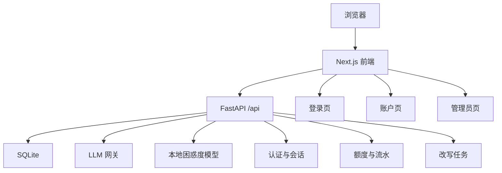
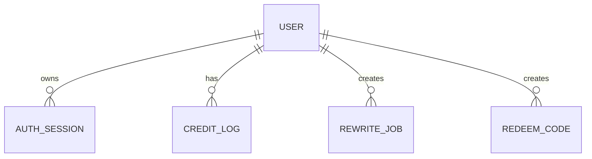

# C 端账号与字数计费

Feature Name: c-end-accounts-credits
Updated: 2026-11-20

## Description

在现有 FastAPI + Next.js 单用户工具上增加账号体系、按实际字数计费的额度、用户级任务隔离和管理员后台。首期不接支付，额度来源为注册赠送、兑换码和管理员调整。

## Architecture

认证采用服务端会话：登录成功后生成随机令牌，数据库只保存令牌的 SHA-256 摘要，浏览器持有 HttpOnly Cookie。所有写操作通过依赖注入获取当前用户，管理员接口额外校验角色。

额度在创建改写任务时按正文字数（去除空白字符后的长度）扣减，扣减与任务写入在同一事务内完成；任务在未产出任何段落前失败时退回本次额度。

## Components and Interfaces

- `app/core/security.py`：scrypt 密码哈希、会话令牌生成与摘要。
- `app/deps.py`：`current_user`、`require_user`、`require_admin` 依赖。
- `app/routers/auth.py`：`POST /api/auth/register`、`POST /api/auth/login`、`POST /api/auth/logout`、`GET /api/auth/me`。
- `app/routers/credits.py`：`GET /api/credits`、`GET /api/credits/logs`、`POST /api/credits/redeem`。
- `app/routers/admin.py`：`GET /api/admin/users`、`POST /api/admin/users/{id}/credits`、`GET/POST /api/admin/redeem-codes`。
- `app/services/credits.py`：扣费、退款、兑换、流水写入。
- `app/routers/rewrite.py`：任务接口要求登录，创建时扣费，失败时退款，查询按用户过滤。
- 前端页面：`/login`、`/account`、`/admin`；`Nav` 展示登录态与余额。

## Data Models

- `user`：id、email（唯一）、password_hash、nickname、credits、is_admin、created_at、last_login_at。
- `auth_session`：id、user_id、token_hash（唯一）、created_at、expires_at。
- `credit_log`：id、user_id、delta、reason、balance_after、created_at。
- `redeem_code`：id、code（唯一）、credits、max_uses、used_count、expires_at、created_by、created_at。
- `rewrite_job` 新增 `user_id`，历史无归属的任务仅管理员可见。

## Correctness Properties

1. 任意时刻 `user.credits >= 0`。
2. 每条流水的 `balance_after` 等于该用户此前的余额加 `delta`。
3. 兑换码 `used_count` 不超过 `max_uses`。
4. 普通用户查询任务只能得到 `user_id` 等于自身的记录。
5. 会话令牌只以摘要形式落库。

## Error Handling

- 未登录访问受保护接口返回 401，前端跳转登录页。
- 额度不足返回 402，响应体包含所需字数与当前余额。
- 邮箱重复返回 409，参数非法返回 422。
- 兑换码无效返回 400 并说明原因。
- 非管理员访问管理接口返回 403。

## Test Strategy

- 后端用 FastAPI TestClient 覆盖注册、登录、重复邮箱、额度不足、兑换码、管理员加额度、任务隔离。
- 前端手动验证登录跳转、余额展示、兑换流程与管理员页面。
- 迁移脚本在已有数据库上执行，确认新增表与 `rewrite_job.user_id` 生效。
